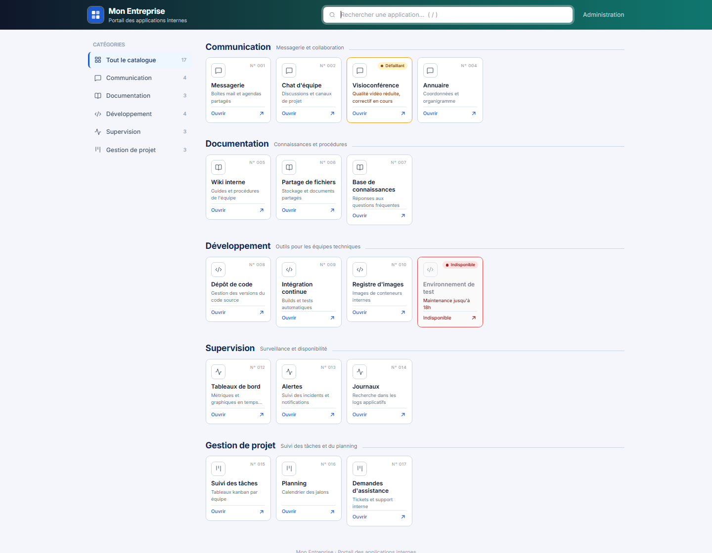

# Portail des applications internes

Catalogue web des applications internes, par catégories, avec recherche et administration.
Flask + SQLite, un seul conteneur. La base vit dans le volume `/data`.



Image Docker : **`fabiosline/portail:1.0`**

## Lancer avec Docker

```bash
docker run -d --name portail \
  -p 8000:8000 \
  -v portail-data:/data \
  -e ADMIN_USER=admin \
  -e ADMIN_PASSWORD='ChangezMoi!' \
  -e PORTAL_NAME='Mon Entreprise' \
  fabiosline/portail:1.0
```

- Portail : http://localhost:8000
- Administration : http://localhost:8000/admin

## Lancer avec Docker Compose

```bash
cp .env.example .env     # puis éditer ADMIN_PASSWORD
docker compose up -d
```

Même résultat que ci-dessus. Le `docker-compose.yml` utilise l'image `fabiosline/portail:1.0` et le volume `portail-data`.

## Configuration

Variables d'environnement (`-e` avec Docker, fichier `.env` avec Compose) :

| Variable | Rôle | Défaut |
|---|---|---|
| `ADMIN_USER` | Identifiant admin | `admin` |
| `ADMIN_PASSWORD` | Mot de passe admin | aléatoire (voir `docker logs`) |
| `PORTAL_NAME` | Nom affiché | `BDUCI` |
| `COOKIE_SECURE` | `1` si servi en HTTPS | `0` |

Changer le mot de passe : modifier la variable, puis recréer le conteneur (`docker compose up -d`). Les données sont conservées.

## Mettre à jour

Changer le tag de l'image dans `docker-compose.yml`, puis :

```bash
docker compose pull && docker compose up -d
```

La base est migrée automatiquement au démarrage. Les données sont conservées.

## Construire l'image (développeur)

```bash
docker build -t fabiosline/portail:1.0 .
docker push fabiosline/portail:1.0
```

## Sauvegarder

```bash
docker exec portail python -c "import sqlite3; sqlite3.connect('/data/portal.db').backup(sqlite3.connect('/data/backup.db'))"
docker cp portail:/data/backup.db ./portal-backup.db
```

## À savoir

- HTTPS : mettre un reverse proxy devant, puis `COOKIE_SECURE=1`.
- Logo : remplacer `app/static/logo.svg` avant le build.
- Tailwind est chargé via CDN : les postes doivent joindre `cdn.tailwindcss.com`.
